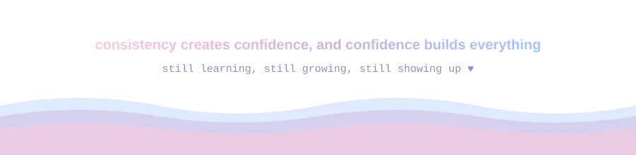

<!-- 🌙 HEADER -->

  

<!-- 💻 ABOUT (terminal) -->

  

<!-- 🌱 CURRENTLY WORKING ON -->

  
  

<!-- 🧰 TECH STACK -->

  
  

<!-- 📊 GITHUB FLOW -->

  
  

<!-- 🧩 PERSPECTIVE -->

  
  

<!-- 🌐 CONNECT -->

  

  
  &nbsp;&nbsp;
  

<!-- 🌊 FOOTER -->

  

